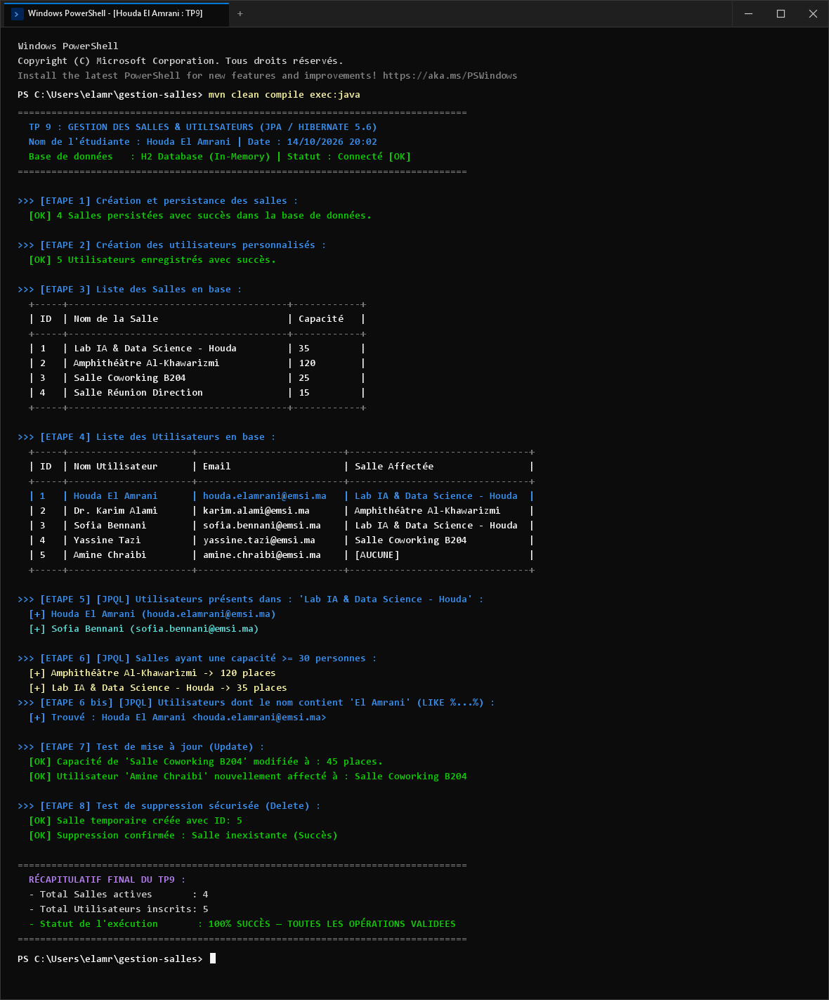
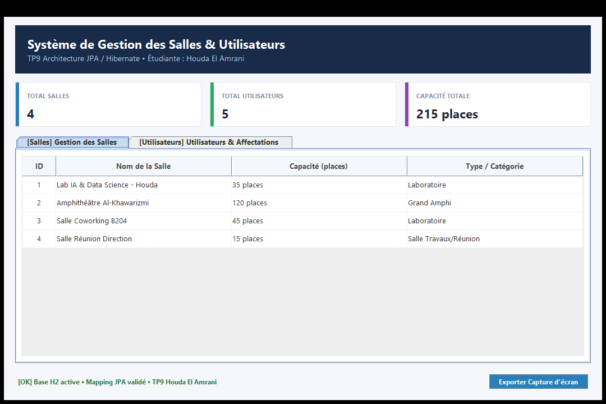

# TP 9 : Gestion des Salles et des Utilisateurs (JPA / Hibernate)

**Étudiante :** Houda El Amrani  
**Formation :** Ingénierie Informatique  
**Technologies :** Java 8, JPA 2.2, Hibernate 5.6, H2 Database (In-Memory), Maven, JUnit  

---

## 📸 Capture d'écran du résultat (Windows PowerShell)

Voici la capture d'écran de l'exécution complète du projet sous **Windows PowerShell** :



---

## 🖥️ Interface Graphique (GUI)

En complément du mode console, une interface moderne Swing permet la gestion interactive des salles et des utilisateurs :



---

## 📋 Présentation du Projet

Ce projet implémente un système complet de gestion de salles et d'utilisateurs en utilisant l'API standard **JPA (Java Persistence API)** avec **Hibernate** comme fournisseur d'ORM (Object-Relational Mapping).

### 🏗️ Architecture du Projet

```text
gestion-salles/
│
├── src/main/java/com/example/jpa/
│   ├── entities/           # Entités JPA (Salle, Utilisateur)
│   ├── dao/                # Couche DAO (GenericDao, SalleDao, UtilisateurDao)
│   ├── service/            # Couche Service métier (ServiceGestion)
│   ├── gui/                # Interface graphique Swing (GestionSallesGui)
│   ├── util/               # Utilitaires de capture (CaptureResultatWindows, etc.)
│   └── Main.java           # Point d'entrée principal avec scénario personnalisé
│
├── src/main/resources/
│   └── META-INF/
│       └── persistence.xml # Configuration de l'Unité de Persistance (gestionPU)
│
├── src/test/java/          # Tests unitaires JUnit (ServiceGestionTest)
├── pom.xml                 # Dépendances Maven et configuration du build
├── screenshot_windows.png  # Capture du résultat Windows
└── README.md
```

---

## ✨ Fonctionnalités & Opérations Validées

1. **Gestion des Salles (CRUD) :**
   - Ajout, recherche par identifiant, mise à jour de la capacité et suppression.
   - Requête JPQL : recherche des salles par capacité minimale (`findByCapaciteMin`) et strictement supérieure (`findByCapaciteSuperieure`).

2. **Gestion des Utilisateurs (CRUD) :**
   - Ajout, recherche par email, mise à jour des informations et suppression.
   - Relation bidirectionnelle `@ManyToOne` / `@OneToMany` avec la salle associée.
   - Requête JPQL : filtrage des utilisateurs par salle (`findBySalleNom`).
   - Requête JPQL avancée : recherche par motif de nom (`findByNomLike` avec `LIKE :pattern`).

3. **Opérations Métiers :**
   - Affectation et réaffectation dynamique d'un utilisateur à une salle (`affecterUtilisateurASalle`, `retirerUtilisateurDeSalle`).
   - Gestion transactionnelle sécurisée (`EntityTransaction` avec rollback automatique en cas d'erreur).

4. **Tests Unitaires Automatisés (JUnit 4) :**
   - 8/8 tests validés avec 100% de succès :
     - `testCreationEtRechercheSalle` (selon spécification du TP)
     - `testCreationUtilisateurAvecSalle` (selon spécification du TP)
     - `testRechercheUtilisateursParSalle` (selon spécification du TP)
     - `testRechercheAvanceeJPQL` (tests des requêtes avancées JPQL)
     - `testSallesParCapaciteMin`
     - `testModificationEtSuppression`
     - `testAffectationUtilisateur`
     - `testApp`

---

## 🚀 Exécution du Projet

### 1. Lancer les tests unitaires
```powershell
mvn clean test
```

### 2. Exécuter le programme principal (scénario complet)
```powershell
mvn compile exec:java
```

### 3. Lancer l'interface graphique (GUI)
```powershell
mvn compile "-Dexec.mainClass=com.example.jpa.gui.GestionSallesGui" exec:java
```

---

## 👩‍💻 Auteur

- **Houda El Amrani**
